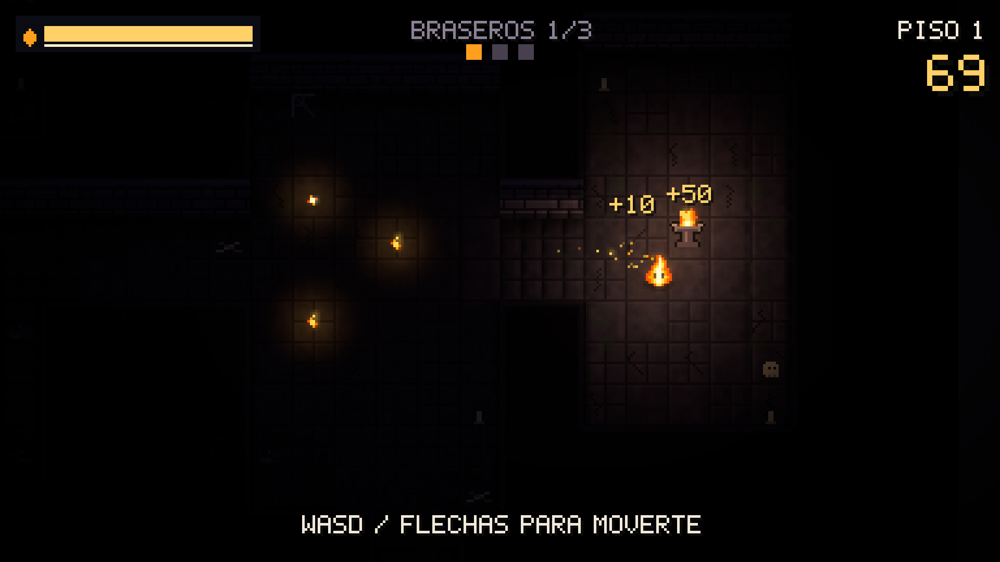

# LUMEN

**Your light is your life, your sight, and your clock.**
A top-down stealth roguelite made in **Unity 6 (URP 2D)**: you're a small living flame in a pitch-black dungeon. Seeing more makes you more visible. Light every brazier to open the exit, and go as deep as you can.



| | |
|---|---|
| **Engine** | Unity 6000.0 LTS · URP 2D Renderer · C# |
| **Platforms** | Windows / Linux (desktop) |
| **Art and audio** | 100% procedural: sprites, normal maps, level and sounds are generated in code at startup. No imported assets |
| **Run length** | 3–15 minutes, instant restart |

## Controls

| Action | Keyboard | Gamepad |
|---|---|---|
| Move | WASD / Arrows | Left stick |
| Dim (stealth) | Shift | LT / LB |
| Flare | Space | A / RT |
| Pause | Esc | Start |

## What's technically interesting

- **Real shadows that drive the gameplay.** Walls cast shadows with `ShadowCaster2D`, generated at runtime from the procedural map (greedy meshing into rectangles). Enemy AI uses the same line of sight as rendering, so if a shadow hides you on screen, the enemy can't see you either.
- **Fully procedural pipeline.** Rooms-and-corridors generator (Prim MST plus extra loops), deterministic per seed. The level is baked into a single texture plus a **normal map** that `Light2D` uses to shade bricks and bevels. Sprites, pixel font and sound synthesis are all code.
- **Clean architecture.** A composition root (`GameManager`), an event hub (`GameEvents`), all numbers in a `ScriptableObject` (`GameTuning`), and an `IPlayerInput` abstraction that lets the same code take keyboard, gamepad or AI.
- **Automated playtesting.** An `AutoPilot` bot plays the real build through `IPlayerInput`. `-playtest N` runs N games and writes `report.json` with telemetry (floor, death cause, flares, embers, hits). It also drives the title screen's *attract mode*.
- **Tests.** EditMode (NUnit) tests for the generator (determinism, reachability, enemy distance), A* and greedy meshing.

## Structure

```
Lumen/Assets/Lumen/
  Scripts/
    Core/      GameManager (composition root), GameEvents, GameTuning, Locale, SaveData
    Level/     DungeonGenerator, DungeonMap, GridPathfinder (A*), LevelBuilder
    Lighting/  LightField (shared line of sight), LightFactory, ShadowCasterCompat
    Player/    PlayerFlame, input (keyboard/gamepad)
    Enemies/   Shade (base), Stalker, Moth, Devourer
    World/     Brazier, Ember, ExitPortal
    Art/       Palette, PixelCanvas, SpriteBank, LevelPainter (albedo + normal map)
    FX/        CameraRig, PixelParticles, Sfx (synthesis), SpriteAnimator
    UI/        PixelFont, PixelText, Hud, Screens
    Bot/       AutoPilot, PlaytestRunner, RunTelemetry
  Editor/      LumenSetup (layers, assets, scene, builds in one click / CLI)
  Tests/       EditMode
docs/GDD.md    full design document
```

## Building

Open `Lumen/` with Unity 6000.0.x and use the **Lumen → Setup Project** menu, then **Lumen → Build**. From the command line:

```bash
Unity -batchmode -quit -projectPath Lumen -executeMethod Lumen.EditorTools.LumenSetup.SetupAndBuildAll
```

Automated playtest:

```bash
Lumen/Builds/Linux/Lumen.x86_64 -batchmode -nographics -playtest 20 -playtestOut playtest
```
