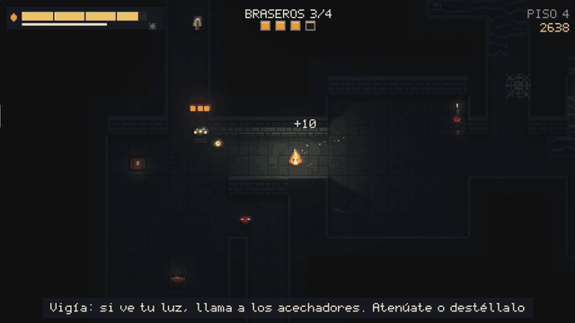
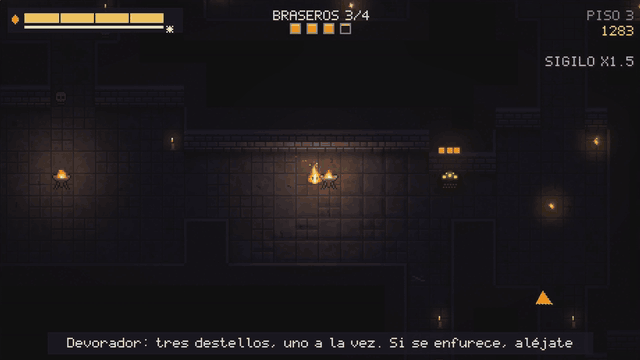
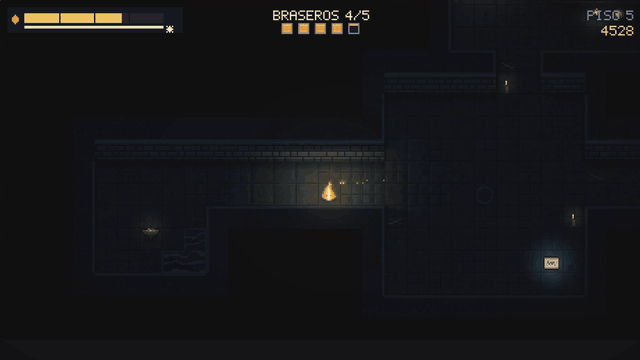
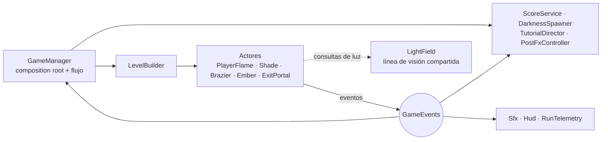

# LUMEN

**Tu luz es tu vida, tu visión y tu reloj.**

Roguelite de sigilo top-down hecho en **Unity 6 (URP 2D)**. Eres una pequeña llama viva en una mazmorra a oscuras, y ver más te hace más visible. Enciende todos los braseros para abrir la salida y baja lo más profundo que puedas.



| | |
|---|---|
| **Motor** | Unity 6000.0 LTS · URP 2D Renderer · C# |
| **Plataformas** | Windows / Linux (escritorio) |
| **Arte y audio** | 100% procedurales: sprites, normal maps, niveles, efectos de sonido y música se generan por código al iniciar, sin assets importados |
| **Partidas** | 3 a 15 minutos, reinicio instantáneo |
| **Idiomas** | Español neutro / English (tecla L en el título) |

## Controles

| Acción | Teclado | Gamepad |
|---|---|---|
| Mover | WASD / Flechas | Stick izquierdo |
| Correr (gasta luz) | Shift | RT |
| Atenuar (sigilo) | Ctrl | LT |
| Destello | Espacio | A |
| Usar objeto activo | E | Y |
| Cambiar objeto activo | Q / Tab | LB / RB |
| Pausa / menú | Esc | Start |

## Cómo se juega

- **El combustible es todo:** vida, radio de luz y tiempo. Se consume solo, y más rápido con luz plena.
- **Atenuar** te vuelve casi invisible y estira el combustible, pero te frena y no quemas a las sombras.
- **Correr** te da velocidad a cambio de arder el triple y brillar más.
- **El destello** quema todo lo que tengas cerca y aturde lo que esté más lejos. Cuesta luz.
- **Los braseros** abren la salida y te recargan, pero cada uno tiene una reserva finita. En Hoguera y Ceniza no hay flechas que los señalen: hay que explorar.
- **Siete sombras:**
  - **Acechador:** te ve más de lejos cuanto más brillas.
  - **Polilla:** la atrae tu luz desde lejos.
  - **Devorador:** inmune a la luz, apaga braseros. Se vence con 3 destellos, uno por vez.
  - **Mímico:** se hace pasar por una brasa hasta que te acercas.
  - **Tejedora:** teje telarañas que te frenan y te drenan; el fuego las quema.
  - **Vigía:** no se mueve, pero si ve tu luz da la alarma y atrae a los acechadores cercanos.
  - **Guardián (jefe, cada 5 pisos):** sella la salida hasta que lo derrotas. Tiene tres fases: embiste, lanza ondas de sombra (atenuar te salva) e invoca acechadores.
- **Cada partida se arma distinta:**
  - **5 llamas jugables**, cada una con su habilidad y su personalidad: Lumen (equilibrada), Brasa (agresiva), Fuego fatuo (sigilo), Chispa (velocidad) y Rescoldo (resistencia).
  - **4 dificultades:** Vela, Antorcha, Hoguera y Ceniza, con récord por cada una.
  - **Bendiciones:** al bajar de piso eliges 1 de 3 cartas.
  - **Objetos:** farol, aceite, señuelo, mapa, llaves y cofres, más brújula, polvo de sombra, bomba de luz y botas de ceniza, que se desbloquean.
  - **Eventos de piso:** Apagón, Lluvia de brasas y Marea.
  - **Bonus de sigilo:** mientras nada te vea, el puntaje se multiplica (hasta x3).
  - **Biomas cada 3 pisos:** criptas con rejas, cavernas inundadas y raíces con viento, cada uno con su propia música.
- **Progresión entre partidas:** el puntaje se convierte en **Cenizas**. Con ellas compras preparativos antes de cada partida y desbloqueas llamas, objetos y bendiciones. También ganas Cenizas cumpliendo **desafíos**. Además hay un **desafío diario** con semilla fija y récord del día.
- **Guía en forma de libro** ilustrado (con paso de página) antes de la primera partida, y consejos contextuales mientras juegas.

| | |
|---|---|
|  |  |

## Lo técnicamente interesante

- **Sombras reales que deciden el gameplay.** Los muros proyectan sombras con `ShadowCaster2D`, generadas en runtime a partir del mapa procedural (greedy meshing en rectángulos). La IA usa exactamente los mismos colliders para la línea de visión, así que si una sombra te tapa en pantalla, el enemigo tampoco te ve.
- **Pipeline 100% procedural.** Generador de salas y pasillos (MST de Prim + loops extra), determinístico por semilla, con una semilla derivada por piso para que las runs completas se puedan reproducir. El nivel se hornea en una textura + **normal map** que `Light2D` usa para sombrear ladrillos y biseles. Los sprites, la fuente pixel y la síntesis de audio son código.
- **Reglas en C# puro, testeables.** `FuelModel` (economía de combustible), `ScoreService` (eventos → puntaje), `DarknessSpawner` (presión anti-campeo), `FloorSettings` (curva de dificultad), `Meta` (Cenizas, desbloqueos, desafíos) y `WoundGate` (ventanas de daño de jefes) no dependen de la escena.
- **Música procedural.** `Music` sintetiza una pista por lugar (título y cada bioma) con cuerdas Karplus-Strong, campanas y pads con reverberación, y hace crossfade al cambiar de bioma.
- **Playtesting automatizado.** Un bot (`AutoPilot`) juega el build real a través de la misma interfaz `IPlayerInput` que el teclado. `-playtest N` corre N partidas a 8× y escribe telemetría (`report.json`: piso, causa de muerte, destellos, golpes por enemigo, etc.). Con `-shots` saca capturas y registra momentos destacados para cortar gifs. El mismo bot juega el *attract mode* del título.
- **Tests:** 72 EditMode y 4 PlayMode.
  - EditMode cubre el generador, A*, greedy meshing, combustible, puntaje, presión, curva de dificultad, dificultades, bendiciones, biomas, ítems, llamas, progresión (Cenizas, desbloqueos, desafíos), música y las sombras nuevas.
  - PlayMode incluye una prueba de humo, que arranca el juego real y exige que el bot complete el piso 1 sin errores, y regresiones del flujo de Game Over.

## Arquitectura



- **`GameManager`** arma la escena (cámara, post-procesado, audio, UI) y maneja el flujo *Título → Jugando ⇄ Pausa → Game Over*. No contiene reglas de juego.
- **Los actores no se conocen entre sí.** Levantan eventos (`BrazierLit`, `EnemyKilled`, `PlayerReachedExit`…) y los sistemas reaccionan: el puntaje, el audio, la telemetría y el HUD se enganchan sin que el gameplay los referencie.
- **Un solo patrón de factory:** `Create()` arma la jerarquía, agrega el componente y le pasa sus referencias con `Init/Setup`. `Awake` solo cachea componentes propios.
- **Todos los números de gameplay** están en el ScriptableObject `GameTuning`. La curva por piso está en `FloorSettings.ForFloor`.

### ¿Por qué la escena está vacía?

La única escena tiene un `GameManager`, y todo lo demás se construye por código. La decisión sale del arte procedural: si los sprites, el nivel y el audio se generan al iniciar, no hay assets que referenciar desde prefabs. Además, el bot y el smoke test pueden levantar el juego completo con una línea (`AddComponent<GameManager>()`). El costo es que la cámara, la UI y el post-procesado no se ajustan desde el inspector. En un proyecto con artistas los movería a prefabs y a un `VolumeProfile` asset, y dejaría procedurales solo el nivel, los sprites y el audio.

## Proceso: telemetría y rondas de revisión

El juego se iteró con **cuatro rondas de revisión**, cada una con un criterio y un nivel de exigencia distintos:
- una jugadora casual;
- un jugador hardcore de roguelikes;
- una lead programmer que evalúa portafolios;
- un crítico de arte y UX.

Revisan capturas reales del build, la telemetría del bot, el GDD y el código. Sus hallazgos se priorizaron y se aplicaron. Algunos ejemplos de la iteración 1 → 2:

| Hallazgo | Evidencia | Cambio |
|---|---|---|
| Disparar destellos parado en un brasero *daba* combustible (+5.6/s) | `report.json`: 1242 destellos contra 19 golpes recibidos en 10 runs | Braseros con reserva finita; destello más caro y con recarga más larga |
| La dificultad dejaba de subir en el piso 9 | El bot llegaba al timeout de 15 min en 4 de 10 runs (piso promedio 12) | Curva que sigue subiendo (más enemigos y velocidad); el bot ahora promedia piso 6 sin timeouts |
| Los braseros apagados parecían yunques | Capturas | Trípode con brasas que laten y flecha al objetivo fuera de pantalla |
| El destello se podía disparar en pausa | Lectura de código | `Controllable = false` al pausar |
| Las texturas del nivel nunca se liberaban | Lectura de código | `LevelInstance : IDisposable` |

El detalle está en [`docs/GDD.md`](docs/GDD.md).

## Estructura

```
Lumen/Assets/Lumen/
  Scripts/
    Core/      GameManager, GameEvents, GameTuning, ScoreService, DarknessSpawner, Locale, SaveData,
               Character, Meta, Blessing, Difficulty, FloorEvents, RunState
    Level/     DungeonGenerator (+ FloorSettings), DungeonMap, GridPathfinder (A*), LevelBuilder
    Lighting/  LightField (línea de visión compartida), LightFactory, ShadowCasterCompat
    Player/    PlayerFlame, FuelModel, input (teclado/gamepad)
    Enemies/   Shade (base), Stalker, Moth, Devourer, Mimic, Weaver, Watcher, Guardian, WoundGate
    World/     Brazier, Ember, ExitPortal, Chest, ItemPickup, Door, Web, WindGust, Lure, LevelHazards
    Art/       Palette, PixelCanvas, SpriteBank, LevelPainter (albedo + normal map)
    FX/        CameraRig, PostFxController, PixelParticles, Sfx y Music (síntesis), SpriteAnimator
    UI/        Hud, FrontEnd, BookScreen + BookArt, BlessingScreen, TutorialDirector, MenuList, PixelFont, PixelText
    Bot/       AutoPilot, PlaytestRunner, RunTelemetry
  Editor/      LumenSetup (capas, assets, escena y builds en un click o por CLI)
  Tests/       EditMode + PlayMode
docs/GDD.md    documento de diseño
```

## Compilar y probar

Abre `Lumen/` con Unity 6000.0.x y usa el menú **Lumen → Setup Project**, después **Lumen → Build**. Por línea de comandos:

```bash
# Setup + builds de Linux y Windows
Unity -batchmode -quit -projectPath Lumen -executeMethod Lumen.EditorTools.LumenSetup.SetupAndBuildAll

# Tests
Unity -batchmode -projectPath Lumen -runTests -testPlatform EditMode
Unity -batchmode -projectPath Lumen -runTests -testPlatform PlayMode

# Playtest automatizado: 20 partidas del bot, reporte en playtest/report.json
Lumen/Builds/Linux/Lumen.x86_64 -batchmode -nographics -playtest 20 -playtestOut playtest
```

## Pendientes conocidos

- El bot no busca llaves ni abre cofres, así que la telemetría no mide esa parte de la economía.
- El bot casi no usa el sigilo: su heurística de atenuar es simple, así que la telemetría de "tiempo atenuado" subestima el uso humano.
- La UI, la cámara y el post-procesado se construyen por código (ver "¿Por qué la escena está vacía?").
- El input del juego usa dispositivos directos del Input System, no un `InputActionAsset`, así que no se pueden remapear los controles.
